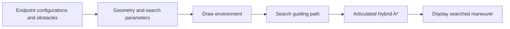

# Hybrid A* for a Tractor with Multiple Trailers

**A MATLAB demonstration of search-based maneuver generation for an articulated vehicle.** The example plans for a car-like tractor towing three trailers through a constrained obstacle layout.

As stated in `RunHA.m`, this code accompanies **Chapter 9, “多体拖挂车的决策规划方法,” of the Chinese book 《自动驾驶决策规划技术理论与实践》 (2021)**. It illustrates the sampling-and-search stage. The complete optimization stages of the related papers are not included in this small demonstration.

## Architecture

A rigid car has a planar pose; a tractor–trailer combination must also track each trailer heading. The configuration here contains `x1`, `y1`, and `theta1` through `theta4`: tractor position and all four body orientations. Clearing an obstacle with the tractor alone does not establish clearance for the trailers.



The visible files define the experiment. Search and drawing engines are distributed as MATLAB P-code and must remain on the MATLAB path.

## Run

```matlab
cd('C:/path/to/HybridAStarForTractorTrailerVehicle');
RunHA;
```

The entry point is **`RunHA.m`**. It clears the workspace, loads the scene, initializes settings, draws the environment and calls the two search components. No AMPL installation is needed for the exposed workflow.

Use MATLAB with **Image Processing Toolbox** for cost-map dilation (`strel`, `imdilate`) and a MATLAB release compatible with the supplied `.p` files. The protected search internals are not exposed; preserve their original files when configuring your environment.

## File guide

| File | Purpose |
| --- | --- |
| `RunHA.m` | One-command demo, book attribution and publication notes. |
| `LoadCase.m` | Initial/goal configurations and four obstacle polygons. |
| `InitializeParams.m` | Body geometry, hitch offsets, search parameters, bounds and cost maps. |
| `DrawBackgroundforHA.p` | Protected environment drawing. |
| `SearchGuidingPath.p` | Protected guiding-path search. |
| `SearchTrajViaHybridAstar.p` | Protected Hybrid A* search for the articulated vehicle. |

## Customize the example

Edit poses and obstacle vertices in `LoadCase.m`. The tractor starts at `(−13, −23)` m and ends at `(22, −23)` m, with all initial and final headings equal to zero. The obstacles require a maneuver around the intervening structure.

Edit vehicle geometry and search settings in `InitializeParams.m`. Default hitch offsets are zero (the on-axle arrangement); the file also specifies trailer lengths, steering samples, motion propagation and search limits. Distances are in meters and angles in radians. Keep all body configurations and collision geometry consistent when changing the vehicle.

This finite-resolution search supplies a route-generation example and an initializer for more detailed optimization. It should not be described as the complete optimal-control methods of the papers below.

## References

The entry script recommends both publications. Please cite the relevant work when using its method.

**Articulated Hybrid A* and progressively constrained optimal control:**

> Bai Li, Tankut Acarman, Youmin Zhang, Liangliang Zhang, Cagdas Yaman, and Qi Kong, “Tractor-Trailer Vehicle Trajectory Planning in Narrow Environments With a Progressively Constrained Optimal Control Approach,” *IEEE Transactions on Intelligent Vehicles*, **5**(3), 414–425, 2020. [DOI](https://doi.org/10.1109/TIV.2019.2960943).

```bibtex
@article{Li2020PCOC,
  author = {Li, Bai and Acarman, Tankut and Zhang, Youmin and
            Zhang, Liangliang and Yaman, Cagdas and Kong, Qi},
  title = {Tractor-Trailer Vehicle Trajectory Planning in Narrow Environments
           With a Progressively Constrained Optimal Control Approach},
  journal = {IEEE Transactions on Intelligent Vehicles},
  volume = {5}, number = {3}, pages = {414--425}, year = {2020},
  doi = {10.1109/TIV.2019.2960943}
}
```

**Safe travel corridors for maneuver optimization:**

> Hangjie Cen, Bai Li, Tankut Acarman, Youmin Zhang, Yakun Ouyang, and Yiqun Dong, “Optimization-based Maneuver Planning for a Tractor-trailer Vehicle in Complex Environments using Safe Travel Corridors,” *2021 IEEE Intelligent Vehicles Symposium (IV)*, pp. 974–979, 2021. [DOI](https://doi.org/10.1109/IV48863.2021.9575439).

```bibtex
@inproceedings{Cen2021SafeTravelCorridors,
  author = {Cen, Hangjie and Li, Bai and Acarman, Tankut and Zhang, Youmin
            and Ouyang, Yakun and Dong, Yiqun},
  title = {Optimization-based Maneuver Planning for a Tractor-trailer
           Vehicle in Complex Environments using Safe Travel Corridors},
  booktitle = {2021 IEEE Intelligent Vehicles Symposium (IV)},
  pages = {974--979}, year = {2021},
  doi = {10.1109/IV48863.2021.9575439}
}
```

The full PCOC implementation is in [TractorTrailerTrajectoryPlanningWithPCOC](https://github.com/libai1943/TractorTrailerTrajectoryPlanningWithPCOC).

## License

See the repository's [GNU Affero General Public License v3](LICENSE) and component notices. Source availability differs between `.m` files and the protected `.p` components.
